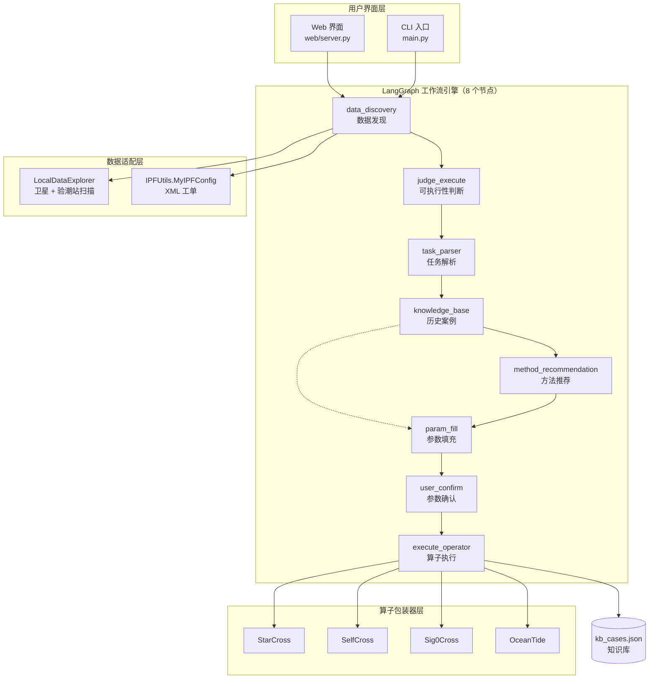

# Cal/Val Agent — 卫星高度计定标验证智能体

**LangGraph 驱动的自动化定标工作流**，覆盖星间交叉、星自交叉、SIG0 交叉、验潮站外推四种定标方法。
支持自然语言下达任务、LLM 推荐方法、历史案例复用、参数体智能填充，以及一键执行 MATCH→CAL。

✨ **核心特性**：LLM 任务解析 · 方法智能推荐 · 历史案例记忆 · 参数体智能填充 · 自然语言改参 · Web 可视化界面 · 验潮站数据自动统计

---

## 🚀 快速开始

### 环境准备

```bash
# Python 解释器（项目指定环境）
# D:/Software/anaconda3/envs/llm/python.exe

# 核心依赖
pip install langgraph langchain langchain-core langchain-openai python-dotenv
pip install netCDF4 h5py python-docx openpyxl cartopy seaborn tables
pip install fastapi uvicorn requests pyyaml

# 配置 LLM API 密钥（默认 DeepSeek）
# 在 .env 写入 DEEPSEEK_API_KEY
```

### 运行方式

**方式一：Web 界面（推荐）**

```bash
cd D:/BaiduSyncdisk/project/202610/calval_agent
"D:/Software/anaconda3/envs/llm/python.exe" web/server.py
# 浏览器访问 http://127.0.0.1:8088
```

**方式二：命令行（LangGraph 工作流）**

```bash
"D:/Software/anaconda3/envs/llm/python.exe" main.py "用 S6A 和 JA3 做 2023 年 5 月的星间交叉"
```

---

## 📐 支持的算子

| 编号 | 名称 | 阶段 | 输入 | 输出 |
|------|------|------|------|------|
| **01** | 星间交叉 (Star Cross) | MATCH + CAL | 两星 NC 目录 | `match_result_*.npz` / `calibration_*.npz` |
| **02** | 星自交叉 (Self Cross) | MATCH + CAL | 同星 NC 目录 | `match_result_*.npz` / 漂移统计 |
| **03** | SIG0 交叉 | MATCH + CAL | 双星 H5/NC | `XOver_data_*.h5` / DOCX 报告 |
| **04** | 验潮站外推 (Tide Ext) | MATCH + CAL | NC + 验潮 TXT | `MATCHED_*.npz` / 绝对偏差 |

每个算子包装器（`operators/*_pipline.py`）提供：

- `run()` — 远程执行（HTTP 调用算子服务）
- `run_local()` — 本地执行（直接调用 GPF 源码；Sig0/OceanTide 的 `run()` 本身即本地）
- `run_match()` / `run_cal()` — 分阶段单独执行

---

## 🏗️ 系统架构

### 层级视图



### 节点输入输出速查

| 节点 | 输入 | 输出 |
|------|------|------|
| `data_discovery` | `config/settings.yaml` | `available_datasets`、`selected_data`、`metadata.data_summary` |
| `judge_execute` | `task_text`、`data_summary.data_describe` | `can_execute`、`reason`、`suggest`（可 interrupt 询问用户） |
| `task_parser` | `task_text`、`data_summary` | `parsed_task`、`branch_path` |
| `knowledge_base` | `parsed_task`、`data/kb_cases.json` | `kb_cases`、`kb_suggestions`、`kb_warnings` |
| `method_recommendation` | `parsed_task`、`available_datasets` | `recommendation`（action/method/confidence/reasoning） |
| `param_fill` | `parsed_task`、`kb_suggestions` | `param_body`、`status: awaiting_user_confirm` |
| `user_confirm` | `param_body`、`user_confirmed` | `param_body`（可能被修改）、`user_confirmed=True` |
| `execute_operator` | `recommendation.method`、`param_body` | `operator_result`、`status`（并追加写入知识库） |

---

## 📂 目录结构

```text
calval_agent/
├── agents/
│   ├── workflow.py                     # LangGraph 图定义 + 路由
│   ├── nodes/
│   │   ├── state.py                    # AgentState 状态定义
│   │   ├── data_discovery_node.py      # 数据扫描 + 统计摘要
│   │   ├── judge_execute_node.py       # LLM 可执行性判断（可交互改任务）
│   │   ├── task_parser_node.py         # 任务解析节点
│   │   ├── task_parser.py              # 自然语言 → 结构化任务（LLM + regex）
│   │   ├── knowledge_base_node.py      # 历史案例匹配与建议
│   │   ├── method_recommendation_node.py
│   │   ├── param_fill_node.py
│   │   ├── user_confirm_node.py
│   │   └── execute_operator_node.py    # 算子调用 + 知识库写入
│   ├── data_adapter/
│   │   └── explorer.py                 # 卫星 + 验潮站数据扫描（新版统计）
│   └── nodes/llm_client.py             # LLM 统一客户端
├── operators/
│   ├── star_cross_pipline.py
│   ├── self_cross_pipline.py
│   ├── sig0_cross_pipline.py
│   ├── ocean_tide_pipline.py
│   └── src/                            # GPF 原始源码（含 __init__.py）
├── core/
│   ├── op_config.py
│   └── utils/utils.py                  # request_data 等工具
├── config/
│   ├── settings.yaml                   # 数据路径（localdata / serverdata）
│   ├── llm_settings.yaml               # LLM 提供商与模型
│   └── SimHei.ttf
├── data/
│   └── kb_cases.json                   # 知识库（每次执行后自动追加）
├── web/                                # FastAPI 后端 + 前端页面
│   ├── server.py
│   ├── index.html
│   ├── styles.css
│   ├── app.js
│   ├── run.bat / run.sh
│   └── README.md
├── main.py                             # CLI 入口
├── .env                                # API 密钥（已 gitignore）
├── .gitignore
├── LICENSE
└── README.md
```

---

## 💾 数据目录结构

```text
D:/BaiduSyncdisk/project/202610/data/
├── satelite/                       # 卫星测高数据（每星一目录）
│   ├── S6A/                        # Sentinel-6 Michael Freilich（76 个 NC）
│   └── JA3/                        # Jason-3（76 个 NC）
└── ocean_tide/                     # 验潮站外推相关
    ├── DTU18MSS_1min.nc            # 平均海面高模型（890 MB）
    ├── FES2014/ocean_tide/         # 34 个潮汐分潮（m2/s2/k1/o1/n2/...）
    ├── HY-2BGDR/<year>/            # HY-2B GDR，按年份
    └── WSTG/                       # 验潮站水位（TXT）
        ├── <year>/<station>/       # e.g. WSTG/2023/zhiwan/
        └── wstg/                   # 扁平布局 also supported
```

**数据探索（新版 `explorer.py`）** 会输出：

- 每个验潮站：站名、经纬度、水深、日文件数、起止日期、总大小、主目录
- 推荐验潮站（按日期范围可用文件数）
- FES2014 分潮清单 + 必需分潮是否齐全
- DTU18 MSS 是否存在与大小
- HY-2B GDR 按年份文件数与日期范围

**配置方式** — 编辑 `config/settings.yaml`：

```yaml
localdata:
  satelite: "D:/BaiduSyncdisk/project/202610/data/satelite"
  ocean_tide: "D:/BaiduSyncdisk/project/202610/data/ocean_tide"

serverdata:
  api_address: "http://192.168.240.133:8000"
  satelite: "/home/leehir/data/satelite"
  oceantide: "/home/leehir/data/oceantide"
```

---

## 🖥️ Web 界面

启动后浏览器访问 `http://127.0.0.1:8088`，页面分四步：

1. **数据发现** — 扫描卫星/验潮站/模型数据，展示完整统计（验潮站表、HY-2B 表、辅助模型键值）
2. **任务描述** — 可执行性判断 / 解析任务 / 查询知识库 / 推荐方法 / 智能化填充参数
3. **参数体确认** — 手动编辑、自然语言修改、确认参数
4. **执行结果** — 统计表格、图片预览、输出文件下载

### API 一览

| 方法 | 路径 | 说明 |
|------|------|------|
| GET  | `/api/health` | 健康检查 |
| GET  | `/api/settings` | 本地/远程数据路径配置 |
| GET  | `/api/discover?mode=local\|remote` | 数据发现 |
| POST | `/api/parse` | 任务解析 |
| POST | `/api/judge` | 可执行性判断 |
| POST | `/api/kb` | 知识库查询 |
| POST | `/api/recommend` | 方法推荐 |
| POST | `/api/param_fill` | 参数体生成 |
| POST | `/api/param_modify` | 自然语言修改参数 |
| POST | `/api/execute` | 提交执行（后台线程） |
| GET  | `/api/jobs/{id}` | 轮询执行状态 |
| GET  | `/api/kb/all` | 全部历史案例 |
| GET  | `/api/file?path=` | 预览/下载输出文件 |

---

## 🔄 工作流节点详解

### 节点 1 · Data Discovery
扫描卫星数据和验潮站数据，生成 `metadata.data_summary`（含卫星统计、验潮站详情、模型状态、文字描述）。
`describe_data_summary()` 生成给 LLM 读的中文摘要，覆盖验潮站站名/经纬度/文件数/日期范围、HY-2B、FES2014、MSS。

### 节点 2 · Judge Execute
LLM 判断现有数据是否可执行。若不可直接执行，会 `interrupt()` 询问用户是否修改任务，用户回复后由 LLM 重写 `task_text`。

### 节点 3 · Task Parser
自然语言 → 结构化任务（`method`、`primary_sat`、`aux_data_type`、`start_date`、`end_date` 等），LLM 优先 + regex 兜底。

### 节点 4 · Knowledge Base
匹配历史案例，输出 `kb_suggestions`（成功案例参数建议）和 `kb_warnings`（失败案例原因），避免重复踩坑。

### 节点 5 · Method Recommendation（可跳过）
`parsed_task.method` 为空时用 LLM 推荐；已有方法则仅校验数据条件。

### 节点 6 · Param Fill
按方法填充完整参数体，并用 LLM 微调 `Match_time`、`Select_Area`、`distance_to_coast`、`ocean_depth`、`wind_speed`。

### 节点 7 · User Confirm
`interrupt()` 挂起，等待用户 `yes` 或自然语言修改。自然语言修改会调用 LLM 生成 JSON patch，更新 `param_body`。

### 节点 8 · Execute Operator
根据 `recommendation.method` 调用对应算子执行 MATCH→CAL，执行后把案例追加写入 `data/kb_cases.json`（去重，保留最近 200 条）。

---

## 🛠️ 配置 LLM

### DeepSeek（默认）

```yaml
# config/llm_settings.yaml
llm:
  provider: "deepseek"
  api_key_env: "DEEPSEEK_API_KEY"
  base_url: "https://api.mlxz.cc/v1"
  model_name: "deepseek-v4-pro"
  temperature: 0.7
```

```bash
echo "DEEPSEEK_API_KEY=sk-xxxx" >> .env
```

> **安全约定**：密钥只写在 `.env`（已加入 `.gitignore`），任何情况下都不进代码或 `llm_settings.yaml`。

---

## 📊 已知问题与解决方案

| 现象 | 原因 | 解决 |
|------|------|------|
| `ModuleNotFoundError: No module named 'src'` | 算子源码包缺 `__init__.py` | 已加 `operators/src/__init__.py` |
| `No module named 'netCDF4'` | 依赖未安装 | 安装 `netCDF4`（指定 conda 环境） |
| `pydantic ValidationError` | 参数体字段类型不对（如 `Match_time` 传 int） | Web 端 `normalize_param_body` 自动归一化 |
| `HTTP 405 / 404`（Web） | 旧 server 进程未重启 | 重启 `web/server.py` |
| `未找到日期范围内的匹配 NPZ` | CAL 输入目录无 MATCH 产物 | 检查 MATCH 输出目录与日期范围 |
| `KeyError: 'AUX_Sat'` | XML 工单缺少该参数 | 确认 `Dynamic_Processing_Parameters` 包含 `AUX_Sat` |
| LLM 调用失败 | 密钥缺失 / 网络不通 | 检查 `.env` 与网络；失败会降级为规则匹配 |

---

## 🧪 测试

```bash
# 完整工作流（会在 user_confirm 节点 interrupt，等待用户确认）
"D:/Software/anaconda3/envs/llm/python.exe" main.py "用 S6A 和 JA3 做 2023 年 5 月的星间交叉"

# Web 界面
"D:/Software/anaconda3/envs/llm/python.exe" web/server.py
# 浏览器访问 http://127.0.0.1:8088
```

---

## 📈 演进路线

### ✅ 已完成（层级 1）

| 模块 | 功能 |
|------|------|
| `data_discovery` | 卫星 + 验潮站 + 模型数据扫描与统计 |
| `judge_execute` | LLM 可执行性判断 + 交互式任务修订 |
| `task_parser` | LLM+regex 解析自然语言 |
| `knowledge_base` | 匹配历史案例，输出建议与警告 |
| `method_recommendation` | LLM 推荐方法，或校验已有方法 |
| `param_fill` | 参数体填充 + LLM 微调 |
| `user_confirm` | interrupt 用户确认 + 自然语言修改 |
| `execute_operator` | 调用算子执行 MATCH→CAL，写入知识库 |
| `web/` | FastAPI 后端 + 前端界面 |

### 🟡 规划中（层级 2）

| 模块 | 功能 | 计划 |
|------|------|------|
| `fallback` | 算子失败后自动调整参数重跑 | Week 7–8 |
| `KnowledgeBase` 写入完善 | 每次执行后把案例持久化到 `kb_cases.json` | 已集成在 `execute_operator_node` |
| CLI / API 包装 | 对外给 Feishu 调用的入口 | 规划中 |

---

## 📝 开发指南

### 添加新算子

1. 从服务器拷源码到 `operators/src/<模块>/{match,cal}/`。
2. 新建包装器 `operators/<模块>_pipline.py`，实现 `run()` 方法。
3. 在 `execute_operator_node.py` 中加入对应 `method` 的 `elif` 分支。

### 调试技巧

```bash
# 使用项目指定的 Python 解释器
"D:/Software/anaconda3/envs/llm/python.exe" main.py "用 S6A 做自交叉"
```

---

## 🤝 贡献说明

1. **本地优先**：默认本地执行，远程模式需单独部署算子服务。
2. **逐层验证**：MATCH → CAL 逐个验证，禁止跳步。
3. **忠实封装**：保持 GPF 原始逻辑，最小化修改。
4. **可复现**：测试数据与配置可追溯。

---

## 📄 许可证

**本项目为非商业许可**：仅供学术研究与教学使用。

**任何商业用途均须事先取得作者书面许可。** 联系方式：1097304039@qq.com

（同样的限制声明亦见于 `.gitignore` 头部与 `LICENSE` 文件。）

---

## 📞 联系方式

1097304039@qq.com

---

**Last Updated**: 2026-11-24 · **Version**: 2.1（Web 界面 + 验潮站统计增强 + judge_execute 节点）